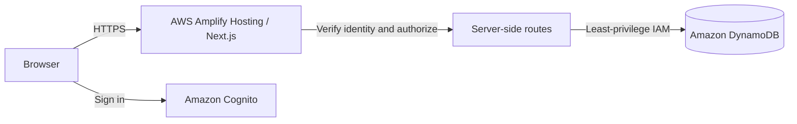

# ACTIVATE

ACTIVATE is a personal productivity app for tasks, habits, goals, and motivation. I’m building it as a hands-on learning project to explore Next.js, Docker, and AWS deployment while creating a useful everyday tool.

**Live demo:** [Open ACTIVATE](https://main.d190afzbyxaqc2.amplifyapp.com/)

The current version is local-first: each browser stores its own data. Accounts, cross-device sync, and AWS-backed persistence are planned, not implemented.

## Run locally

Requires Node.js 20.9 or later and npm. From this folder:

```sh
npm install
npm run dev
```

Visit http://localhost:3000. Development and production use separate build folders so a production build will not disrupt a running development server. If the layout is unstyled after an update, stop the dev server with Ctrl+C, run `npm run dev` again, and refresh the browser. Run `npm test` for the date and activity tests, and `npm run build` for a production build.

## What works

- Today dashboard, daily progress, tasks, scheduled habits, and streaks.
- Create, edit, complete, and delete tasks; filter by date or status. Dates, times, notes, categories, and links are optional.
- Daily and selected-weekday habits, check-ins and undo, with current and longest streaks.
- Goals with milestones and progress; activity heatmap and basic insights.
- Light/dark appearance, responsive navigation, a local profile, 12/24-hour preference, JSON backup/restore, and browser-local persistence.
- Motivation notes, links, and image or video files stored locally in IndexedDB (up to 25 MB per file). Motivation items and files are not yet included in the JSON backup; browser data clearing removes them.

Data is stored in this browser's local storage. It is not synchronized between devices or accounts, backed up, encrypted, or protected by a login; clearing browser storage deletes it. This is a local prototype, not a multi-user cloud service. The weekly-frequency schedule, full habit calendars, a weekly chart, and completion rate are future work. Task completion history records only the current completion state, so undoing a task removes its contribution. The app currently uses JavaScript and custom CSS, not TypeScript, Tailwind, or shadcn/ui.

## Docker

The image was built and its homepage and public assets were verified locally with Podman. Docker Compose has not been tested here. With Docker and Compose installed, run `docker compose up --build` and open http://localhost:3001. Stop with Ctrl+C, then `docker compose down`. The Compose port is bound to this computer only. The app's browser data is separate at each origin, so data from localhost:3000 won't automatically appear at localhost:3001. Motivation files are not included in the current backup.

For a detailed beginner-friendly explanation, installation guidance, exercises, and troubleshooting, read [Docker and hosting lesson](ACTIVATE%20Brain/04%20-%20Docker%20and%20hosting%20lesson.md).

## Future AWS architecture

The following is a proposal, not deployed or implemented:



Before deployment, implement and test Cognito authentication, server-side validation and per-user authorization, and DynamoDB persistence. Never trust a client-supplied user ID. Keep secrets server-side and use IAM roles with least privilege. Define a migration and backup strategy for local data. For an initial public demo, the current local-first app can be deployed to Amplify without those backend services; visitors’ data will remain in their own browsers. For accounts and cross-device sync, implement the backend first. The public demo is hosted on AWS Amplify; account-based synchronization remains future work.

Amplify build and hosting, Cognito, DynamoDB, data transfer, logging, and any optional services can incur charges. Free allowances and account eligibility vary and change; check the current AWS pricing and free-tier pages before deploying. Set AWS Budgets alerts and review Cost Explorer and service usage. A budget alert does not cap spending. No cost estimate can be reliable without current pricing, account eligibility, and expected usage.

## Project knowledge

Open `ACTIVATE Brain` as an Obsidian vault to find the project overview, decisions, and roadmap. Screenshot placeholder: add a real screenshot after reviewing the running app.

The ACTIVATE logo is a custom vector wordmark with a blue lightning bolt beside the wordmark. Reusable light and dark variants are in `public/activate-logo.svg` and `public/activate-logo-dark.svg`.
